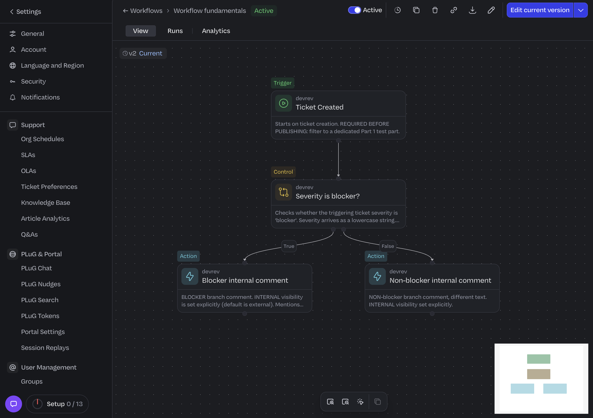
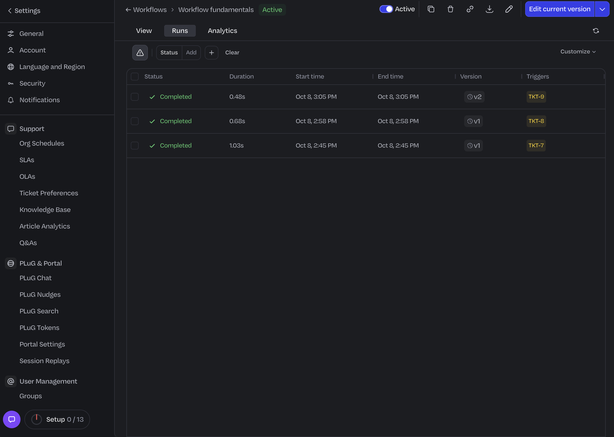
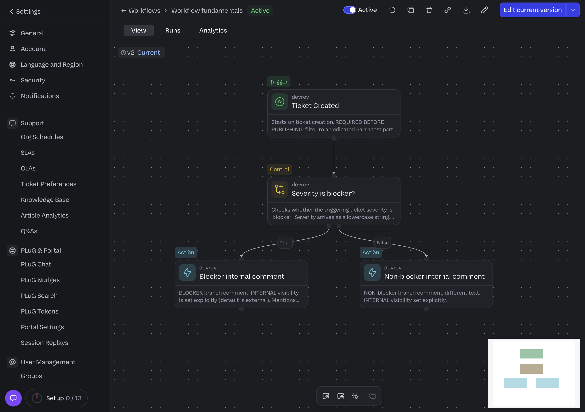
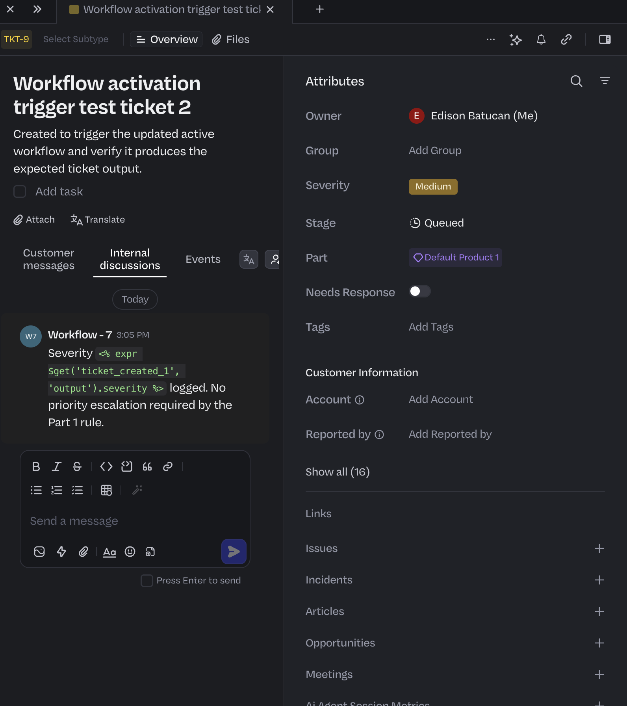

# Part 1 - screenshot checklist

 - workflow canvas showing trigger -> If/Else -> both comment branches. workflow is now active.
 - Runs tab showing a successful run (1)
 - Runs tab showing a successful run (2)
 - the ticket with the automated internal comment
