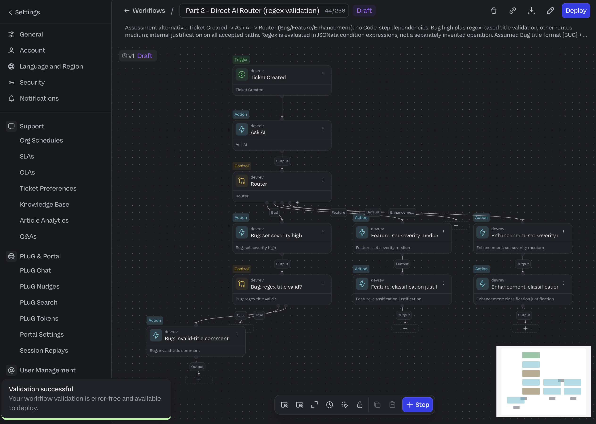
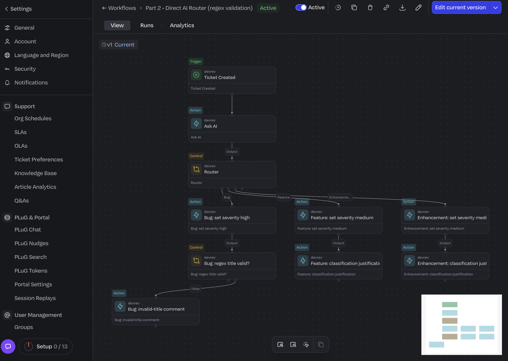
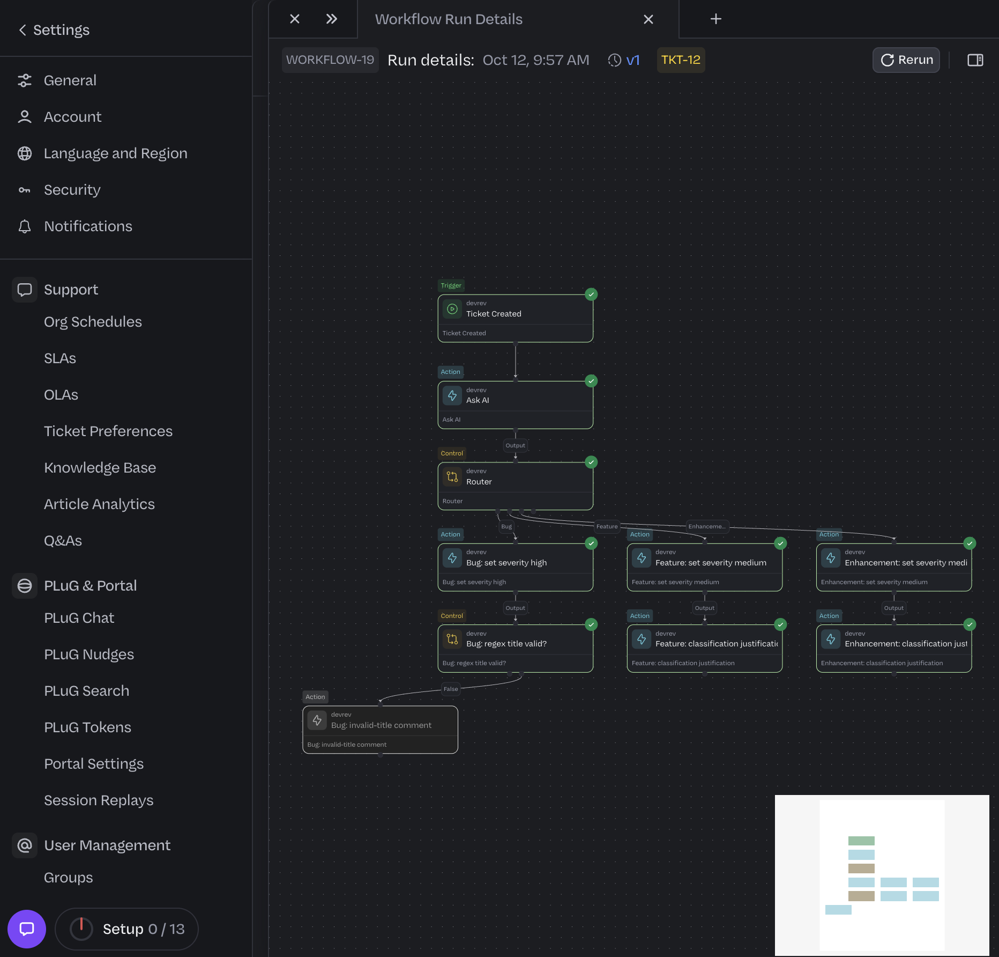
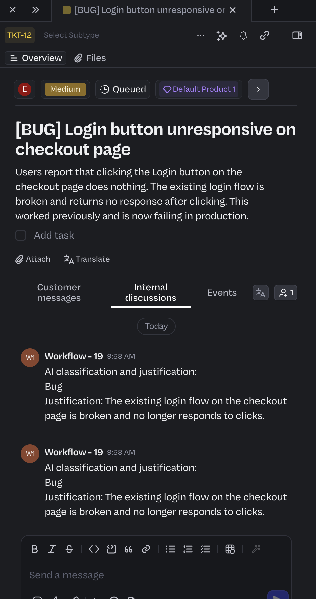
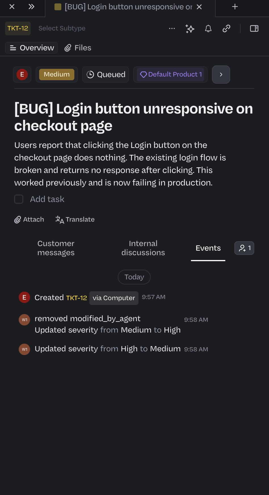

# Part 2 - screenshot checklist

Capture in `edison-org-for-test`; save real images here (no fabrication).

- [✓]  - full canvas showing Ticket Created -> Ask AI -> Router
      with exactly 3 named paths (Bug/Feature/Enhancement).
- [✓]  - a Bug ticket with severity auto-set to
      High and the validation (invalid-title) comment.
- [✓]   - a Feature ticket with the classification
      justification comment and severity Medium.