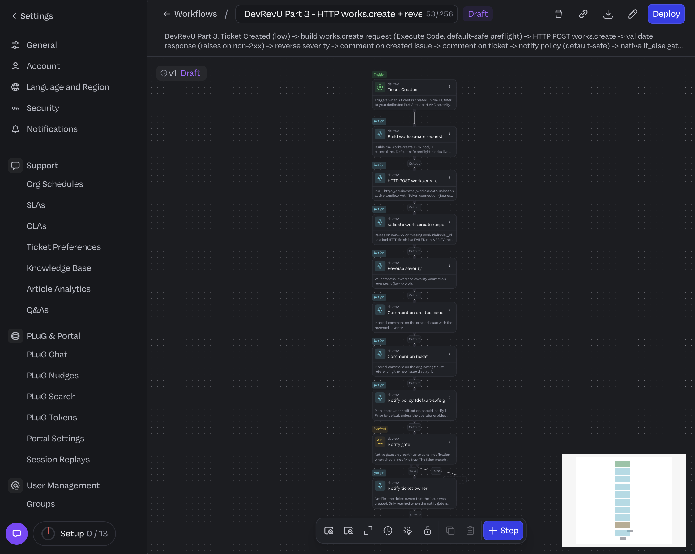
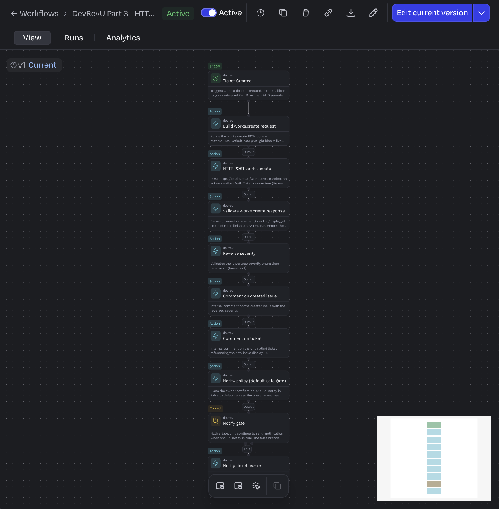
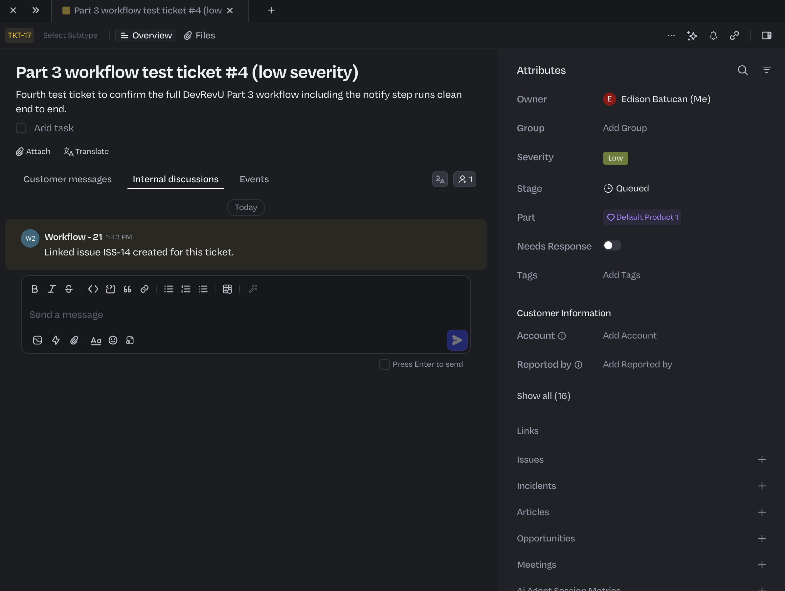
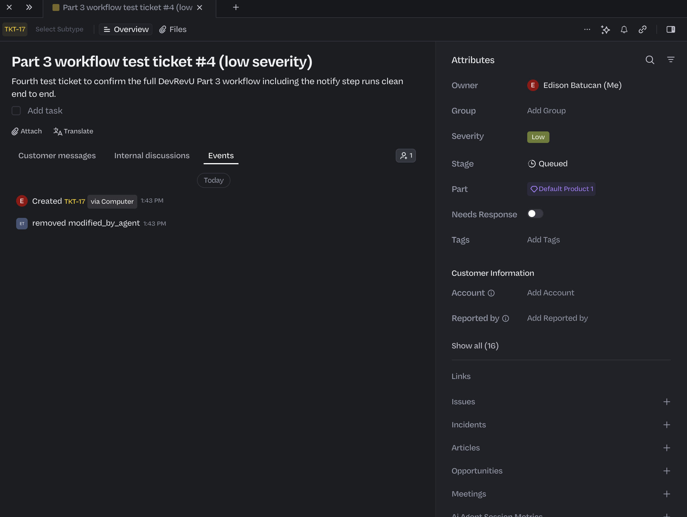
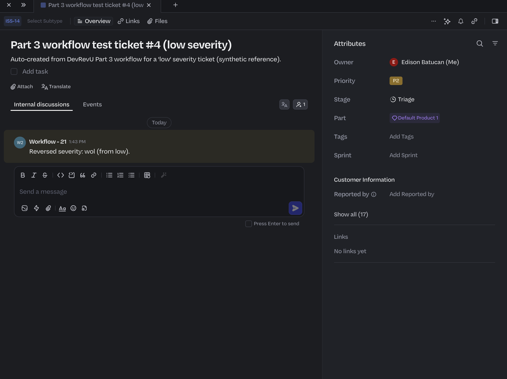
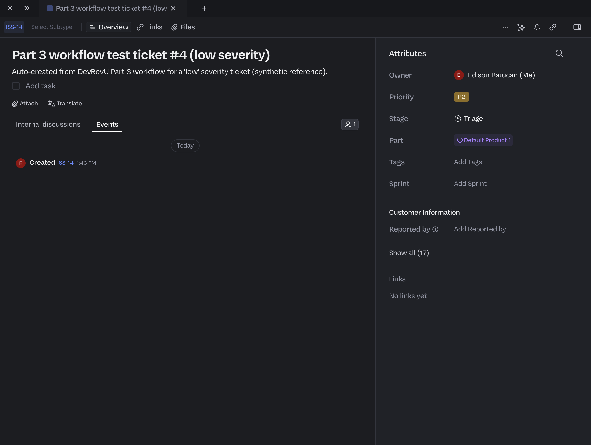
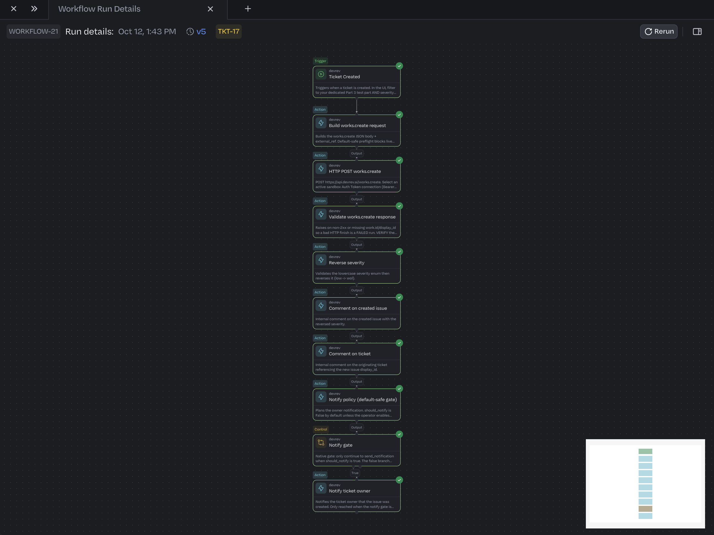
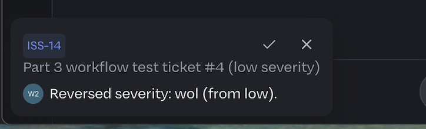
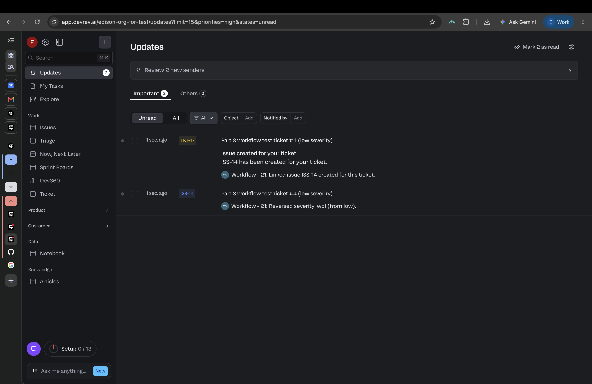

# Part 3 - Workflow evidence

Add your screenshots below. Use build.md for setup. Hide tokens and private data (mask the
Authorization header / connection). Capture everything in `edison-org-for-test`.

## What this workflow does

When a low-severity ticket is created, it POSTs to `works.create` to open an issue, reverses
the severity, comments on both the issue and the ticket, and notifies the ticket owner with
the new ISS id. Note: the generated template `templates/12-Part 3-template.json` is still an
import draft - live import and run are UNVERIFIED until you actually import it.

## 1. Template imported

Image: 

What it shows: the draft template actually opens in the builder. This is the step that is
currently unverified, so this proof matters most.

## 2. Active workflow

Image: 

What it shows: the workflow is active, with the HTTP and Execute Code steps connected.

## 3. Ticket and issue comments

Image:    

What it shows: the reversed-severity comment on the issue and the ISS reference comment back
on the ticket.

## 4. Workflow run

Image: 

What it shows: a real run going through the nodes.

## 5. Owner notification

Image: 

What it shows: the message contains the created issue ID. Label previews clearly; they do
not prove delivery. Use only your own test account for a live notification check.

## Notes (keep real ids out of git)

- Low-severity test ticket display_id:
- Created issue display_id:
- Confirmed response path for work.id / display_id:
