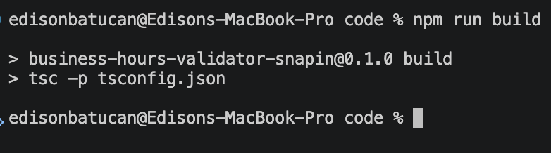
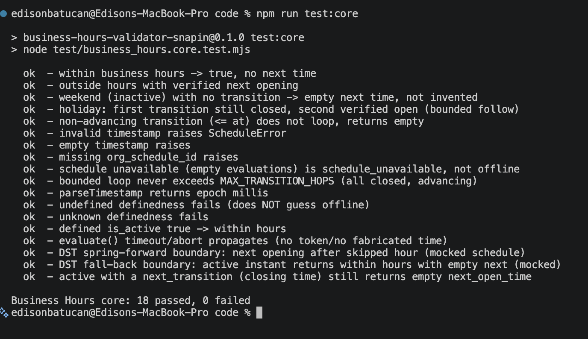
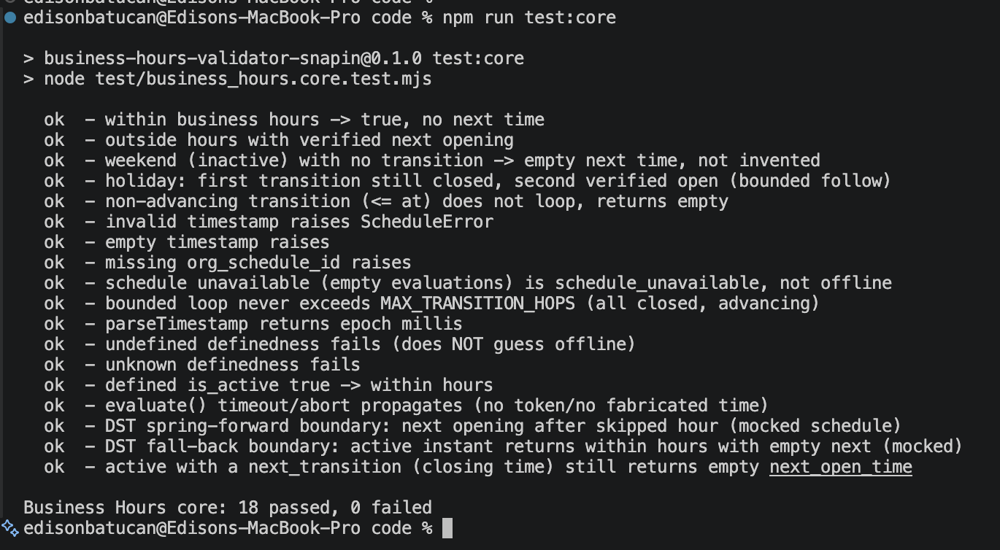
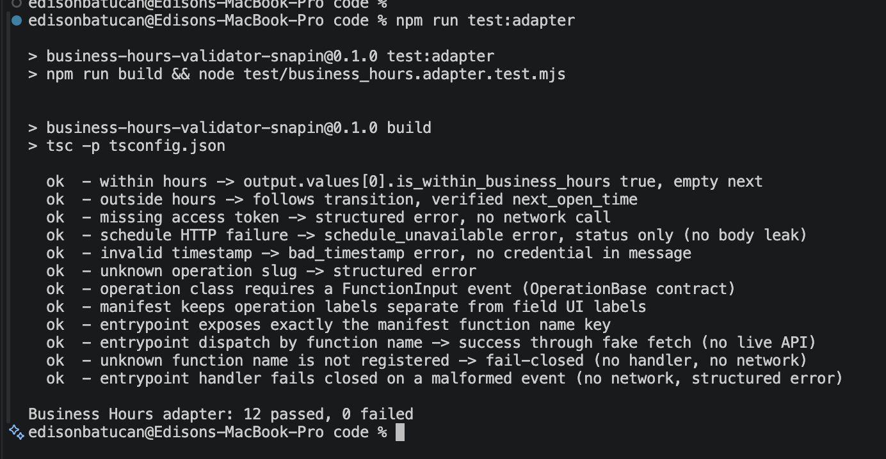
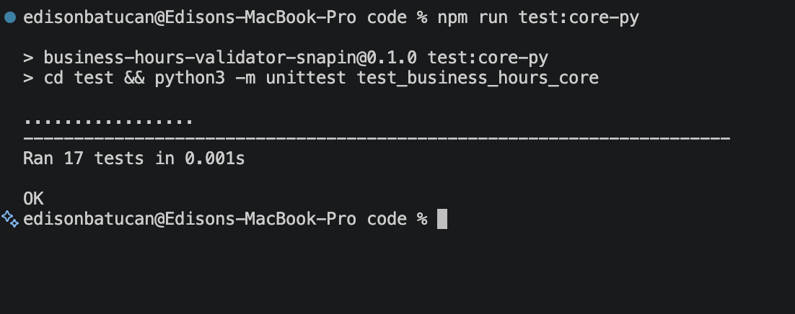

# Part 4 - Local test evidence

Add your terminal screenshots below. Use `../BUILD-GUIDE.md` for the commands.

These are local tests with mocked schedule responses. They do not show a deployed snap-in or a live workflow.

## What is checked

The code checks a timestamp against a supplied schedule response and returns whether it is within hours and the next opening time. The tests cover both outcomes and safe error handling.

## 1. Successful build

Image: 

What it shows: the TypeScript code compiles successfully.

## 2. Within business hours

Image: 

What it shows: the mocked case passes, asserting `true` and an empty next opening time.

## 3. Outside business hours

Image: 

What it shows: the mocked case passes, checking `false` and the next opening against the supplied responses.

## 4. Adapter and function tests

Image: 

What it shows: function registration, inputs, outputs, and error handling pass without real API calls.

## 5. Error cases

Image: 

What it shows: the local tests handle invalid timestamps, missing schedule data, and other edge cases.

## Scope

Local verification passed; screenshots are still placeholders. No sandbox installation, active workflow, live routing, or actual customer reply is claimed.
