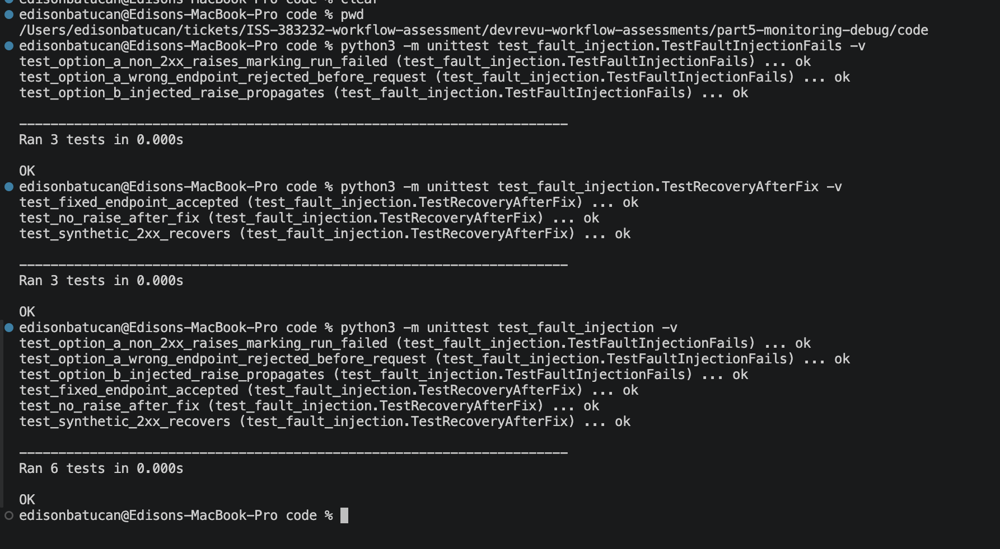

# Part 5 - Local test evidence

Add your terminal screenshots below. Use `../BUILD-GUIDE.md` for the commands.

These tests use synthetic input and make no API calls. They are not screenshots of DevRev workflow Runs or an AI error explanation.

## What is checked

The validator rejects controlled faults and accepts valid input after the fault is removed.

## 1. Fault detection

Image: 

What it shows: the local tests detect the invalid endpoint, non-success response, and injected exception. `OK` means the expected faults were caught.

## 2. Recovery after the fix

Image: 

What it shows: the correct endpoint and synthetic success response are accepted, and normal validation no longer raises.

## 3. Complete local result

Image: 

What it shows: the local failure and recovery checks pass together.

## Scope

Local tests passed; screenshots are still placeholders. No failed hosted workflow run, AI-generated explanation, published-version recovery, or live notification is claimed.
